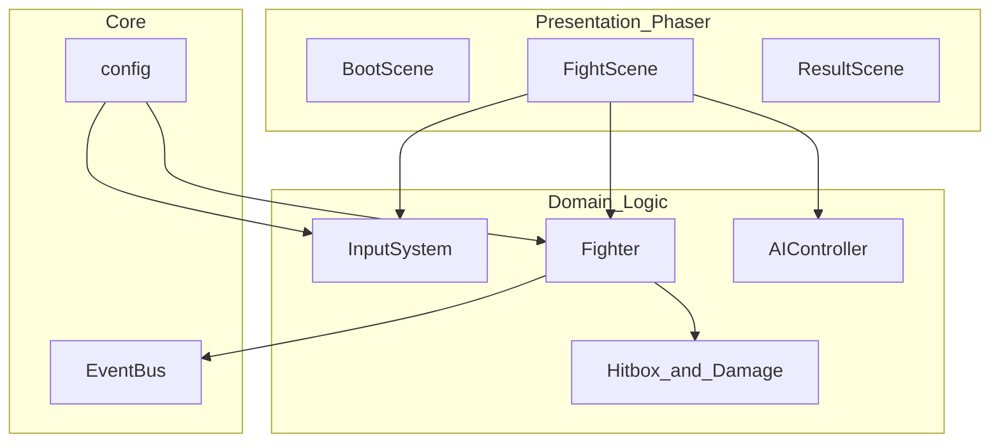

# 系统架构

## 分层概览



## 模块职责

| 模块 | 路径 | 职责 |
|------|------|------|
| InputSystem | `src/input/InputSystem.ts` | 键盘采样、边沿检测、攻击/冲刺缓冲 |
| Fighter | `src/entities/Fighter.ts` | 状态机、位移、hurtbox/hitbox、受击 |
| AIController | `src/entities/AIController.ts` | CPU 简易决策（靠近、攻击、偶尔冲刺） |
| Hitbox | `src/combat/Hitbox.ts` | AABB 相交检测 |
| EventBus | `src/core/EventBus.ts` | 跨模块事件（KO、伤害飘字等） |
| Scenes | `src/scenes/*` | 渲染、HUD、场景切换 |

## 固定步长循环（设计）

MVP 将逻辑放在 Phaser `Scene.update(time, delta)` 中，用 **delta 累加器** 保证每帧最多推进固定逻辑步：

```typescript
const FIXED_DT = 1000 / 60;
let accumulator = 0;

update(_time: number, delta: number) {
  accumulator += delta;
  while (accumulator >= FIXED_DT) {
    this.fixedUpdate(FIXED_DT);
    accumulator -= FIXED_DT;
  }
  this.renderInterpolate(accumulator / FIXED_DT);
}
```

MVP 简化：`fixedUpdate` 与单次 `update` 合并，假定 60Hz 稳定；后续可拆 accumulator。

## 与 Phaser 的边界

**在 Phaser 内做：**

- 精灵创建、翻转（`setFlipX`）、位置同步
- 键盘 `keydown` / 每帧 `isDown`
- 矩形 Graphics 调试绘制（hitbox）
- 文本 HUD、场景 `scene.start`

**不在 Phaser Physics 做：**

- 攻击判定、伤害、硬直帧
- 重击（Dash + J）规则

**可选 Arcade Physics：**

- 垂直重力、`body.blocked.down` 判地（Fighter 使用）

## 数据流（单帧）

1. `InputSystem.poll()` 读取 P1 按键
2. `Fighter.updateLogic(input)` 状态转移、生成 hitbox
3. `AIController.tick()` 生成 P2 虚拟输入
4. `CombatResolver.checkHits(p1, p2)` 双向检测，应用伤害与 Hitstun
5. 同步 sprite 位置与 HUD

## 状态机（Fighter）

见 [combat-design.md](./combat-design.md) 状态图。实现文件：`Fighter.ts` 内 `switch (state)` 或小型状态表。

## 扩展点

- 新角色：复制 `config/fighters.ts` 条目 + 帧表
- 新招式：在 `config/moves.ts` 增加 MoveDef
- 联机：将 `InputSystem` 抽象为 `InputSource` 接口，网络层注入帧输入（Phase 4）
