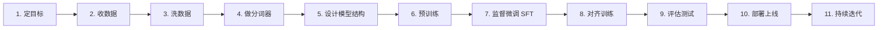

# 大模型是怎么「造」出来的？——大白话全流程说明

> 本文用尽量通俗的语言，讲清楚一个大语言模型（LLM）从「零」到「能用」的完整过程。  
> 每个步骤都会说明：**在干什么、为什么需要、需要什么技术/资源**。

---

## 先打个比方：大模型像什么？

你可以把大模型想象成一个**读了海量书、又经过专门培训的新员工**：

1. **预训练**：让他把图书馆里的书尽量都读一遍，学会语言规律和常识。
2. **微调（SFT）**：教他怎么按公司要求回答问题、写报告。
3. **对齐（RLHF/DPO 等）**：教他什么该说、什么不该说，说话要 helpful、harmless、honest。
4. **上线部署**：把他放到客服系统、写作助手等产品里，让用户真正用起来。

下面按时间顺序，一步一步拆开讲。

---

## 全流程总览



---

## 第 1 步：定目标——先想清楚要造什么样的模型

### 在干什么？

团队先回答几个根本问题：

- 这个模型主要干什么？（聊天、写代码、翻译、做 Agent……）
- 要多大？（7B、70B、还是更大）
- 支持哪些语言？（中文为主还是多语言）
- 预算和时间有多少？
- 是从头训练，还是在开源模型上继续训练？

### 为什么需要？

没有目标，后面所有工作都会跑偏。  
比如：要做代码助手，数据就要偏代码；要做手机端小模型，就不能按 1000 亿参数去设计。

### 技术要求

| 类别 | 具体内容 |
|------|----------|
| **产品/业务** | 明确使用场景、用户群体、成功指标（准确率、延迟、成本） |
| **技术选型** | Transformer 架构、参数量级、上下文长度（如 8K/128K） |
| **资源评估** | GPU 数量与型号（如 A100/H100）、存储、网络带宽、训练周期 |
| **合规** | 数据版权、隐私、内容安全、行业监管要求 |
| **路线选择** | 全量预训练 vs 继续预训练 vs 仅微调开源底座 |

---

## 第 2 步：收集数据——给模型准备「教材」

### 在干什么？

从各种来源收集文本（有时也包括代码、图像描述等），例如：

- 网页（Common Crawl 等）
- 书籍、论文
- 维基百科
- 代码仓库（GitHub）
- 对话数据、问答数据
- 人工标注的高质量数据

### 为什么需要？

**数据是大模型的燃料。**  
模型不会「凭空聪明」，它学到的东西，本质上来自训练数据里的模式。

### 技术要求

| 类别 | 具体内容 |
|------|----------|
| **数据采集** | 爬虫、API、公开数据集、授权采购、合成数据生成 |
| **数据规模** | 预训练通常需要 TB 级甚至 PB 级原始文本 |
| **数据多样性** | 覆盖多领域、多文体、多语言，避免偏科 |
| **存储** | 对象存储（S3/OSS）、分布式文件系统（HDFS 等） |
| **版权与合规** | 过滤侵权内容、敏感个人信息、违法内容 |
| **数据版本管理** | 记录数据来源、清洗版本，便于复现和审计 |

---

## 第 3 步：清洗与预处理——把「脏教材」变成「好教材」

### 在干什么？

原始数据里有很多垃圾，需要过滤和整理：

- 去掉广告、乱码、重复网页
- 去掉低质量、过短、无意义文本
- 去重（同一篇文章出现很多次会浪费算力）
- 过滤有害、色情、暴力等内容
- 统一格式（编码、换行、特殊符号）
- 按语言分类、按质量打分

### 为什么需要？

**Garbage in, garbage out**——脏数据训出来的模型也会「学坏」或变笨。  
清洗质量往往直接决定模型上限。

### 技术要求

| 类别 | 具体内容 |
|------|----------|
| **去重算法** | MinHash、SimHash、精确哈希等 |
| **质量评估** | 困惑度打分、分类器过滤、启发式规则 |
| **内容安全** | 敏感词、NSFW 检测、PII（个人身份信息）脱敏 |
| **分布式处理** | Spark、Ray、MapReduce 等大规模数据处理框架 |
| **流水线** | 可重复的数据处理 DAG，支持增量更新 |
| **人工抽检** | 抽样审核，验证清洗策略是否有效 |

---

## 第 4 步：构建分词器（Tokenizer）——教模型认识「字词单位」

### 在干什么？

计算机不能直接读汉字或英文单词，需要把文本切成 **token（词元）**，再转成数字 ID。  
常用方法是 **BPE（Byte Pair Encoding）** 或 **SentencePiece**。

例如：「人工智能」可能被切成 `「人工」「智能」` 或更细的子词。

### 为什么需要？

- 分词方式影响模型效率（同样一句话，token 越少越省算力）
- 中英文、代码、emoji 的切分能力会影响模型表现
- 分词器一旦固定，后面训练和推理都要用它，**不能轻易改**

### 技术要求

| 类别 | 具体内容 |
|------|----------|
| **算法** | BPE、WordPiece、Unigram、SentencePiece |
| **词表大小** | 常见 32K～128K，要在压缩率与覆盖率间平衡 |
| **多语言支持** | 中文、英文、代码、数字、符号的统一编码 |
| **训练语料** | 用与预训练相近的语料训练 tokenizer |
| **工具** | Hugging Face `tokenizers`、SentencePiece 库 |
| **特殊 token** | `<bos>`、`<eos>`、`<pad>`、`<unk>` 等占位符设计 |

---

## 第 5 步：设计模型结构——搭建「大脑」的骨架

### 在干什么？

确定模型的神经网络结构。当前大模型几乎都用 **Transformer** 架构，主要包括：

- **Embedding 层**：把 token ID 变成向量
- **多层 Transformer Block**：自注意力（Self-Attention）+ 前馈网络（FFN）
- **输出层**：预测下一个 token 的概率

还要决定：

- 层数（如 32 层、80 层）
- 隐藏维度（hidden size）
- 注意力头数（attention heads）
- 是否用 GQA/MQA（分组查询注意力，省显存）
- 上下文窗口长度（context length）
- 是否加入 MoE（混合专家，稀疏激活）

### 为什么需要？

结构决定了模型的**能力上限、训练成本、推理速度**。  
同样 70B 参数，不同结构设计，效果和效率可以差很多。

### 技术要求

| 类别 | 具体内容 |
|------|----------|
| **深度学习框架** | PyTorch、JAX 等 |
| **架构知识** | Transformer、RoPE 位置编码、RMSNorm、SwiGLU 等 |
| **分布式设计** | 模型并行、流水线并行、张量并行的接口预留 |
| **数值稳定性** | 混合精度（FP16/BF16）、梯度裁剪、初始化策略 |
| **参考实现** | LLaMA、GPT、Qwen 等开源架构的可复现设计 |
| **配置管理** | 用配置文件（YAML/JSON）管理超参数，便于实验 |

---

## 第 6 步：预训练（Pre-training）——让模型「读万卷书」

### 在干什么？

这是**最烧钱、最耗时**的一步。  
模型读海量文本，做一件事：**给定前面的词，预测下一个词**（自回归语言建模）。

训练完成后，模型已经具备：

- 语法、常识、部分推理能力
- 一定的知识记忆
- 但还不会很好地「听指令」，也可能说话不安全

### 为什么需要？

预训练让模型获得**通用的语言理解和生成能力**，相当于打地基。  
没有预训练，后面微调效果会很差。

### 技术要求

| 类别 | 具体内容 |
|------|----------|
| **算力** | 成百上千张 GPU/TPU，训练数周至数月 |
| **分布式训练** | 数据并行（DDP）、张量并行（TP）、流水线并行（PP）、ZeRO 等 |
| **训练框架** | Megatron-LM、DeepSpeed、FSDP、Colossal-AI 等 |
| **优化器** | AdamW，配合 warmup、cosine 学习率调度 |
| **批量大小** | 全局 batch size 常需很大（如百万 token 级）以保证稳定 |
| **Checkpoint** | 定期保存权重，支持断点续训 |
| **监控** | 训练 loss、梯度范数、吞吐（tokens/s）、硬件利用率 |
| **显存优化** | 梯度检查点、Flash Attention、序列并行 |
| **数据加载** | 高效 dataloader，避免 GPU 空等 |

### 常见指标

- **训练 token 数**：如 1T（1 万亿）、15T tokens
- **算力消耗**：常用 **FLOPs** 或 **GPU·小时** 衡量
- **Loss 曲线**：应平稳下降，异常尖峰说明训练不稳定

---

## 第 7 步：监督微调（SFT / Fine-tuning）——教模型「怎么干活」

### 在干什么？

用**高质量的「指令-回答」数据**继续训练，让模型学会：

- 听懂用户问题
- 按格式回答（列表、代码块、步骤说明）
- 在特定任务上表现更好（翻译、摘要、写 SQL 等）

数据形式通常是：

```json
{
  "instruction": "把下面这句话翻译成英文：今天天气很好。",
  "output": "The weather is nice today."
}
```

### 为什么需要？

预训练模型像「读过很多书但没岗前培训的人」——  
SFT 就是**岗前培训**，教它按产品要求工作。

### 技术要求

| 类别 | 具体内容 |
|------|----------|
| **标注数据** | 人工编写或 GPT 辅助生成 + 人工审核 |
| **数据量** | 通常万级到百万级高质量样本（质量 > 数量） |
| **训练方法** | 全参数微调，或 LoRA/QLoRA 等参数高效微调 |
| **超参数** | 较小学习率（如 1e-5 ~ 5e-5），较少 epoch（1~3） |
| **格式模板** | ChatML、Alpaca 等对话模板，保持训练推理一致 |
| **防过拟合** | 验证集监控、早停、数据多样性 |
| **工具** | Hugging Face TRL、LLaMA-Factory、Axolotl 等 |

---

## 第 8 步：对齐训练——让模型「说人话、做好人」

### 在干什么？

SFT 之后，模型可能：

- 答非所问
- 产生有害内容
- 过度啰嗦或讨好用户
- 编造事实（幻觉）

对齐训练的目标是：让模型回答**更有用、更安全、更诚实**。

常见方法：

### 8.1 RLHF（基于人类反馈的强化学习）

1. 收集人类对多个回答的排序（哪个更好）
2. 训练**奖励模型（Reward Model）**
3. 用 PPO 等强化学习算法，让模型获得更高奖励

### 8.2 DPO / ORPO / KTO 等（更简单的偏好对齐）

直接用偏好数据优化模型，省去单独训练奖励模型和 RL 环节，**更稳定、更省钱**。

### 为什么需要？

**能力 ≠ 可用性。**  
对齐是把「会说话的模型」变成「产品里能放心用的助手」。

### 技术要求

| 类别 | 具体内容 |
|------|----------|
| **偏好数据** | 人工排序、AI 辅助标注、红队测试反馈 |
| **奖励模型** | （RLHF 路径）独立训练 RM，注意 reward hacking |
| **RL 算法** | PPO、GRPO 等；需 KL 散度约束，防止模型偏离太远 |
| **DPO 类方法** | 实现简单，显存友好，工业界越来越常用 |
| **安全策略** | 拒答机制、敏感话题处理、越狱（jailbreak）防护 |
| **红队测试** | 专门人员/自动化探针，试图诱导模型输出有害内容 |

---

## 第 9 步：评估与测试——考试，看它到底行不行

### 在干什么？

在模型上线前，用多种方式「考试」：

**自动评测（Benchmark）**

- MMLU（多学科知识）
- GSM8K（数学）
- HumanEval（代码）
- C-Eval / CMMLU（中文）
- MT-Bench（多轮对话质量）

**人工评测**

- 专家打分：准确性、流畅度、有用性、安全性
- A/B 对比：新旧模型哪个更好

**专项测试**

- 幻觉率、长文本理解、工具调用、Agent 能力
- 压力测试：高并发、极端输入

### 为什么需要？

训练 loss 下降 ≠ 用户觉得好用。  
评估是上线前的**质量闸门**。

### 技术要求

| 类别 | 具体内容 |
|------|----------|
| **评测框架** | OpenCompass、lm-evaluation-harness 等 |
| **评测集管理** | 固定版本，避免数据泄露到训练集 |
| **指标体系** | 准确率、BLEU、ROUGE、Win Rate、Elo 分数 |
| **人工评测平台** | 盲评、多人一致性（Cohen's Kappa） |
| **回归测试** | 每次迭代对比历史版本，防止能力回退 |
| **安全评估** | 毒性检测、偏见测试、隐私泄露测试 |

---

## 第 10 步：部署上线——让用户真正用起来

### 在干什么？

把训练好的模型放到服务器或端侧，提供 API 或产品功能：

1. **模型格式转换**：合并 LoRA 权重、量化（INT8/INT4/FP8）
2. **推理服务**：搭建高可用 API
3. **接入产品**：聊天界面、插件、Agent 框架
4. **监控运维**：延迟、错误率、成本、内容安全

### 为什么需要？

再强的模型，用户访问不到就没有价值。  
部署阶段要解决的是**速度、成本、稳定性**。

### 技术要求

| 类别 | 具体内容 |
|------|----------|
| **推理引擎** | vLLM、TensorRT-LLM、TGI、llama.cpp、SGLang |
| **量化** | GPTQ、AWQ、GGUF，在精度与速度间权衡 |
| **服务架构** | Kubernetes、负载均衡、自动扩缩容 |
| **KV Cache** | 缓存历史 attention，加速多轮对话 |
| **批处理** | Continuous batching，提高 GPU 利用率 |
| **API 设计** | OpenAI 兼容接口、流式输出（SSE/WebSocket） |
| **安全网关** | 输入输出审核、速率限制、鉴权 |
| **SLA 指标** | P99 延迟、QPS、可用性 99.9%+ |

### 常见部署形态

| 形态 | 适用场景 |
|------|----------|
| 云端 API | 通用助手、SaaS 产品 |
| 私有化部署 | 金融、政务、企业内部 |
| 端侧/边缘 | 手机、PC 本地运行（小模型） |
| 混合架构 | 小模型本地 + 大模型云端 |

---

## 第 11 步：持续迭代——模型不是一锤子买卖

### 在干什么？

上线之后还要不断：

- 收集用户反馈和 bad case
- 补充训练数据，做小版本微调
- 修复幻觉、安全漏洞
- 跟进新架构、新硬件优化
- 定期全量或增量预训练（大版本升级）

### 为什么需要？

用户需求在变，竞争对手也在进步。  
**模型生命周期管理**和最初训练一样重要。

### 技术要求

| 类别 | 具体内容 |
|------|----------|
| **数据飞轮** | 日志采集、脱敏、标注、再训练闭环 |
| **版本管理** | 模型 registry（MLflow、W&B、自研平台） |
| **灰度发布** | Canary 部署，小流量验证再全量 |
| **可观测性** | 追踪 prompt、response、工具调用链 |
| **成本控制** | 监控 token 消耗、GPU 利用率，优化缓存策略 |
| **合规审计** | 保留决策记录，满足监管要求 |

---

## 一张表看清：各阶段要什么资源

| 阶段 | 主要投入 | 典型周期 | 难度 |
|------|----------|----------|------|
| 定目标 | 产品 + 架构师 | 1～4 周 | ★★☆☆☆ |
| 收数据 | 数据工程师 | 持续进行 | ★★★☆☆ |
| 洗数据 | 数据工程师 | 数周～数月 | ★★★☆☆ |
| 分词器 | NLP 工程师 | 数天～数周 | ★★☆☆☆ |
| 模型设计 | 算法架构师 | 数周 | ★★★★☆ |
| 预训练 | 算法 + 工程 + 大量 GPU | 数周～数月 | ★★★★★ |
| SFT | 算法 + 标注团队 | 数天～数周 | ★★★☆☆ |
| 对齐 | 算法 + 安全团队 | 数周 | ★★★★☆ |
| 评估 | 算法 + QA | 持续进行 | ★★★☆☆ |
| 部署 | 后端 + 运维 | 数周 | ★★★★☆ |
| 迭代 | 全团队 | 长期 | ★★★☆☆ |

---

## 常见路线：不是每个人都要从头训

现实中，大多数团队**不会从第 1 步做到第 6 步的全量预训练**（太贵）。常见三种路线：

### 路线 A：全量自研（OpenAI、DeepSeek 等）

```
收数据 → 洗数据 → 预训练 → SFT → 对齐 → 部署
```
- **要求**：海量数据 + 万卡级算力 + 顶级工程团队

### 路线 B：继续预训练（Continue Pre-training）

```
开源底座 → 补充领域数据继续预训练 → SFT → 对齐 → 部署
```
- **适用**：法律、医疗、金融等垂直领域
- **要求**：中等算力 + 高质量领域数据

### 路线 C：微调开源模型（最常见）

```
开源模型（如 Qwen、LLaMA）→ SFT → 对齐（可选）→ 部署
```
- **适用**：创业公司、企业内部助手
- **要求**：少量 GPU（甚至单卡 LoRA）+ 高质量指令数据

---

## 关键技术名词速查（大白话版）

| 名词 | 大白话解释 |
|------|------------|
| **Token** | 模型读文字的最小单位，类似「词片段」 |
| **参数量（7B/70B）** | 模型「脑容量」大小，越大通常越强，也越贵 |
| **Transformer** | 当前大模型的主流「大脑结构」 |
| **预训练** | 海量阅读，学语言和知识 |
| **SFT** | 教它按指令完成任务 |
| **RLHF** | 让人类打分，强化「好回答」 |
| **DPO** | 不用强化学习也能做偏好对齐，更简单 |
| **幻觉** | 模型一本正经地胡说八道 |
| **量化** | 把模型「压缩」变小变快，略损精度 |
| **LoRA** | 只训练一小部分参数，省钱省时 |
| **上下文窗口** | 一次能「记住」多长的对话/文档 |
| **推理** | 模型已经训好，用户提问时生成回答的过程 |

---

## 总结：一句话串起来

> **大模型的创造 = 好数据 + 大算力 + 对架构 + 预训练打地基 + 微调教干活 + 对齐保安全 + 评测把关 + 部署服务 + 持续迭代。**

如果用最朴素的话说：

1. **找书**（数据）
2. **挑书**（清洗）
3. **读书**（预训练）
4. **培训**（SFT）
5. **立规矩**（对齐）
6. **考试**（评估）
7. **上岗**（部署）
8. **进修**（迭代）

---

## 延伸阅读建议

想深入某一步，可以按关键词搜索：

- 数据：`FineWeb`、`Deduplication`、`Data Quality Filtering`
- 训练：`Megatron-LM`、`DeepSpeed ZeRO`、`Flash Attention`
- 微调：`LoRA`、`QLoRA`、`LLaMA-Factory`
- 对齐：`RLHF`、`DPO`、`Constitutional AI`
- 推理：`vLLM`、`Quantization GPTQ/AWQ`
- 评估：`OpenCompass`、`lm-evaluation-harness`

---

*文档版本：v1.0 | 适用读者：零基础到入门工程师 | 最后更新：2026-08-23*
