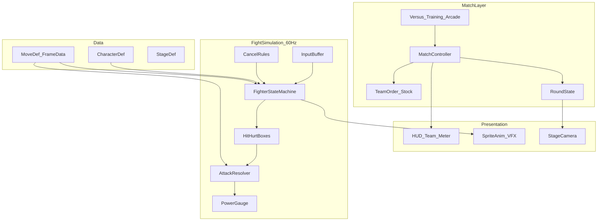

# 原创 Q 版格斗 MVP（拳皇 2002 品类）— Godot 4 规划

目标：玩法高仿《拳皇 2002》核心闭环（**3 人小队制、气槽、取消、超必杀、同屏 1v1/2P**），视觉改为 **Q 版**；第一版只做 **3～4 个原创角色**，先把连招手感与判定打透，再扩人。

> 版权：不使用 SNK / 《拳皇》角色名、立绘、音效、商标、原版素材。做成**同品类原创 3v3 小队格斗**；系统可对齐 2002（气槽、MAX、紧急回避、Guard Crush 等），角色与舞台均为原创 Q 版。

**已锁定选型**：引擎 **Godot 4**；MVP 范围 **本地同屏 + 3～4 角色**（不做联网）。

---

## 1. MVP「能玩」定义（验收标准）

满足以下全部即算 MVP 达标：

| 能力 | 验收 |
|------|------|
| 对战形式 | **本地 1P vs 2P** 同屏；也支持 **1P vs CPU** |
| 队伍规则 | 每方选 **3 人顺序**；击倒换下一人，三人都倒判负 |
| 角色 | **4 个原创 Q 版角色**（数据驱动招式表）；首发可先用 3 人开打，第 4 人作训练对照 |
| 基础战斗 | 走/跑/跳/蹲、轻中重拳脚、近远距离分支、防御、受击硬直 |
| 2002 味系统 | **气槽**、特殊技、必杀/超必杀、**取消链**、紧急回避（或等价闪避）、Guard Crush（可简化数值） |
| 模式 | **Versus**、**Training**（可开关防御/气槽/复位）、**Arcade**（打 3～4 关简易 AI） |
| 手感底线 | 战斗逻辑 **60 FPS 定票**；输入缓冲 ≤ 8 帧；连招可在训练场稳定复现 |
| 表现 | Q 版占位立绘/动画可读；受击闪光、击退、UI 血条/气槽/队序完整 |

明确砍掉（非 MVP）：联网对战、回放/录像、完整 40+ 人角色表、故事模式精修、商城/皮肤、在线排行、完美复刻每一个 2002 隐藏系统。

---

## 2. 推荐技术选型（已锁定）

| 层 | 选择 | 原因 |
|----|------|------|
| 引擎 | **Godot 4.3+**（4.x 稳定版） | 2D 管线成熟、场景轻、适合同屏格斗 |
| 语言 | **GDScript** 为主；`core/` 纯逻辑可抽成可测脚本 | 迭代快；复杂帧数据用 Resource/JSON |
| 渲染 | CanvasItem 2D + 正交相机 | 侧视 2D；Q 版精灵/骨骼二选一，MVP 用精灵帧动画 |
| 物理 | **不用刚体推挤**；自定义 AABB 攻击框/受击框 + 推挤求解 | 格斗判定可控、与帧数据一致 |
| 输入 | InputMap + 动作缓冲队列 | 键鼠调试；预留手柄轴映射 |
| 数据 | `.tres` Resource 或 JSON 招式表 | 帧数、伤害、取消窗口热调 |
| AI | 有限状态机（靠近/防/对空/放技能） | Arcade / 练习假人够用 |
| 资源 | 色块灰盒 → Q 版像素/矢量精灵替换 | 先跑通系统再美 |

备选（本规划不采用）：Unity（本仓库已有 MOBA，格斗另起 Godot 更轻）、联网 rollback（非 MVP）。

---

## 3. 总体架构



**权威模型（本地）**：单机权威模拟；1P/2P 只注入输入。所有伤害、硬直、气槽只在 `FightSimulation` 内结算，表现层只读快照播动画。

**定票率**：战斗逻辑固定 **60 Tick/s**（`1/60` 秒）；渲染跟随显示器刷新，对逻辑状态插值仅用于位移表现（可选）。

---

## 4. 核心系统拆解

### 4.1 帧与状态机

每名角色运行时帧字段：

- `state`：Idle / Walk / Dash / Crouch / Jump / Attack / Block / HitStun / Knockdown / Wakeup / Dead
- `state_frame`：当前状态已过帧
- `facing`：±1
- `pos`、`vel`：逻辑坐标（像素或单位统一）
- `hitstop`：双方停顿帧
- `juggle`：浮空次数/衰减

攻击态由 `MoveDef` 驱动：startup / active / recovery，逐帧挂 HitBox。

### 4.2 攻击框 / 受击框

- 每帧可有多个 HurtBox、0～N 个 HitBox
- 碰撞：AABB（可后期加圆形）
- 同一招对同一目标 **单次命中锁**（hitbox group id）
- 属性：伤害、气增减、击退、hitstun、blockstun、高低段、是否弹开、是否吹飞

### 4.3 取消与连招（对齐 2002 精神）

数据字段 `cancel_into`：

- 普攻 → 特殊技 / 必杀（指定等级窗口）
- 特殊技 → 超必杀（耗气）
- 可做简化：**轻→中→重** 链 + **特殊取消** + **超必杀取消**，不做完整 CMD 表拷贝

输入：方向 mid-frame 缓冲 + 招式指令（如 `↓↘→ + 拳`）在 N 帧窗口匹配。

### 4.4 气槽（Power Gauge）

- 满格分段（建议 3 格）；攻击/防御/受击涨气，规则用表配置
- 消耗：必杀强化 / 超必杀 / MAX 类强化（MVP 做 **超必杀 + 一档强化必杀** 即可）
- UI：底部气槽条 + 当前格数

### 4.5 3 人小队

- 赛前选 3 人顺序（可重复角色：**不允许**，强制不重复）
- 当前出战 1 人；HP≤0 → 击倒演出 → 下一人跳入（短暂无敌）
- 三人全倒 → 回合/比赛结束

### 4.6 模式流

```
Boot → Title → CharacterSelect(队序) → Versus|Training|Arcade
  → Fight → WinLose → 回选人/标题
```

---

## 5. 内容规格（原创 Q 版）

### 5.1 首发 4 角色（名称可改）

| ID | 定位 | 手感一句话 | 必杀方向 |
|----|------|------------|----------|
| C01 赤焰 | 均衡扑手 | 中距离压制 + 小跳跃压制 | 火属性波动 / 冲拳 / 超必杀爆发 |
| C02 青影 | 迅敏连段 | 快节奏取消、擦枪位移 | 手里剑类弹道 / 瞬步 / 多段超 |
| C03 岩岳 | 重装破防 | 慢起步高伤害、Guard Crush 强 | 投技 / 近身重脚 / 霸体超 |
| C04 铃风 | 诈术对空 | 对空强、低空射击 | 旋风弹 / 升龙类 / 全屏超 |

每名角色最少招式集：

- 站立/蹲/跳 轻中重 × 拳脚（可合并部分动画）
- 1～2 特殊技、2 必杀、1 超必杀、1 投、前/后紧急回避

### 5.2 Q 版美术约束

- 头身比约 **1:1.5～1:2**；剪影攻击可读优先于细节
- 调色：高对比角色色 + 浅色舞台，避免泥色糊成一团
- 受击：夸张挤压、击退线、短 hitstop（4～8 帧）
- **禁止**直接描摹原版拳皇像素或使用商业 ROM 拆包资源

### 5.3 舞台

- MVP **1 个侧视舞台**（平地 + 左右边界墙）
- 逻辑宽度固定；相机跟随两人中点并夹紧

---

## 6. Godot 工程目录建议

```
KofQMvp/
  project.godot
  README.md
  docs → ../docs/kof-q-mvp/
  assets/
    characters/          # Q版精灵、动画
    stages/
    ui/
    audio/
  data/
    characters/          # C01.tres / moves/*.json
    balance/
  scenes/
    boot.tscn
    title.tscn
    char_select.tscn
    fight.tscn
    training.tscn
  scripts/
    core/                # 定票模拟、框体、伤害（少依赖节点）
      sim/
      combat/
      input/
      data/
    match/               # 队序、回合、模式
    ai/
    presentation/        # 动画、相机、VFX 桥接
    ui/
  tests/                 # 可选 GUT 或命令行脚本测帧数据
```

---

## 7. 分阶段实施计划

| Phase | 目标 | 详情 |
|-------|------|------|
| 0 | 工程骨架 | 场景流、双角色灰盒、走跳边界、相机 |
| 1 | 互殴闭环 | 框体、普攻、防御、伤害、单人 KO |
| 2 | 2002 核心系统 | 指令技、气槽、超必杀、取消、回避 |
| 3 | 小队 3v3 | 队序、换人登场、4 角色数据化 |
| 4 | 模式与 AI | Training、Arcade、简易 CPU |
| 5 | Q 版表现与验收 | 动画/特效/音效、手感调参、清单勾选 |

每阶段产出：可运行场景 + 对应 `PHASEx.md` 进度记录 + 验收项。

---

## 8. 风险与对策

| 风险 | 对策 |
|------|------|
| 手感「不像格斗」 | Phase 1～2 只磨 1 人互殴；训练场逐帧显示框与 cancel |
| 招式硬编码爆炸 | 强制 MoveDef 数据驱动；角色脚本只挂特殊判定钩子 |
| Q 版攻击判定难读 | 放大 active 帧特效轮廓；攻击框略大于美术刀光 |
| 范围蔓延到联网/全人表 | README 砍刀清单；扩人单独立项 Phase 6+ |
| 版权误用 | 角色命名/视觉审核清单；禁止 ROM 拆包 |

---

## 9. 文档索引

见 [INDEX.md](INDEX.md)。
