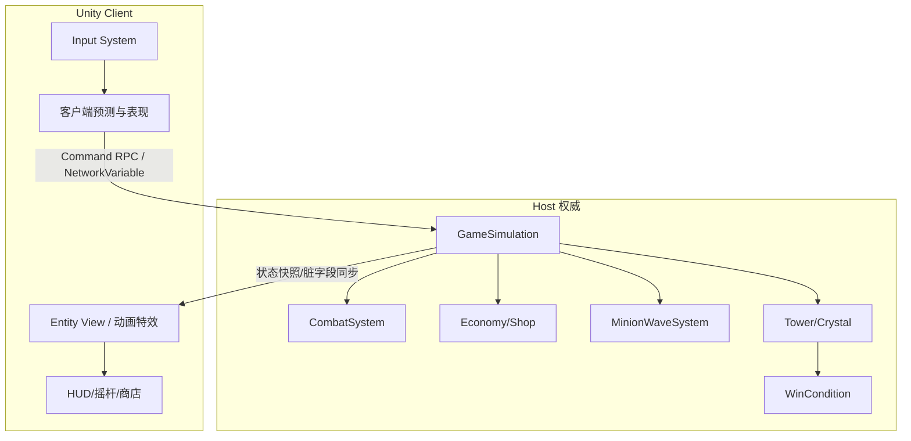

# 原创 MOBA MVP（王者类玩法）— Unity 规划

目标：**局域网 1v1 / 3v3 可对战**，核心操作与推塔胜负闭环，不追求完整排位/商城/百英雄。

> 版权：不使用《王者荣耀》角色、皮肤、地图、音效、UI、商标。做成**同品类原创 MOBA**，玩法对齐「5v5 推塔 MOBA 的精简版」。

---

## 1. MVP「能玩」定义（验收标准）

满足以下全部即算 MVP 达标：

| 能力 | 验收 |
|------|------|
| 对战人数 | 支持 **1v1** 与 **3v3**（同房间，缺人可用简单 AI 补位） |
| 联网 | **局域网 Host/Client**（Unity Netcode for GameObjects + Unity Transport） |
| 英雄 | **4 个原创英雄**（坦克 / 刺客 / 法师 / 射手各 1），各含 被动 + 3 主动 + 大招 |
| 操作 | 虚拟摇杆移动、普攻锁定、技能摇杆方向/锁定释放 |
| 战场 | 单路或三路简化地图：我方/敌方 **1 座高地塔 + 1 水晶**；可选中路野区 2 个野怪点 |
| 兵线 | 定时出兵，兵线互相交战并推塔 |
| 经济 | 击杀/助攻/兵线/推塔给金币；商店买 **6 件基础装备** |
| 胜负 | 摧毁对方水晶 → 结算面板（KDA、金币、时长） |
| 手感底线 | 60 FPS 目标（中端机）；技能 CD/伤害/控制在数值表可调 |

明确砍掉（非 MVP）：排位、匹配服、皮肤商城、完整野区/河道之灵、视野草丛博弈深度、回城读条精修、打野装备线、英雄熟练度、录像系统。

---

## 2. 推荐技术选型（已锁定）

| 层 | 选择 | 原因 |
|----|------|------|
| 引擎 | **Unity 6 LTS**（或 2022.3 LTS） | 手游/PC 双端、Netcode 生态成熟 |
| 渲染 | URP + 俯视角正交/近正交相机 | 性能友好，贴近王者观察角 |
| 联网 | **Netcode for GameObjects (NGO)** + Unity Transport | 官方维护，Host 模式适合局域网 MVP |
| 输入 | Input System + 屏幕虚拟摇杆 | 一套代码兼顾键鼠调试与触屏 |
| 数据 | ScriptableObject + CSV/Google Sheet 导出 | 技能数值、装备、英雄配置热调 |
| 物理 | 不靠刚体推挤；**自定义圆形碰撞 + 扇形/矩形技能判定** | MOBA 判定更可控 |
| AI | 行为树或简易状态机（补位 bot） | 3v3 缺人可开房 |
| 资源 | 低模 + 占位色块 → 后期换美术 | 先跑通玩法 |

备选（本规划不采用）：Mirror（社区方案）、Photon Fusion（云服务成本）、自研 UDP（工期过高）。

---

## 3. 总体架构



**权威模型**：Host（房主）跑完整模拟；客户端发输入指令；关键状态（HP、位置、金币、塔血）由 Host 同步。技能表现可在本地立即播（乐观），以 Host 结算为准做校正。

**定票率**：模拟 **20 Tick/s**（足够手游 MOBA MVP）；渲染与输入 60 Hz。

---

## 4. 核心系统拆解

### 4.1 实体与属性

统一 `CombatEntity`：

- 阵营、最大/当前生命、攻击力、法强、护甲、魔抗、移速、攻击距离、攻击间隔
- 状态：眩晕、减速、沉默、霸体、无敌（用 `StatusEffect` 列表 + 剩余时间）
- 死亡：英雄进入死亡计时复活；小兵/野怪销毁；塔不可复活

### 4.2 移动与普攻

- 摇杆输出世界平面方向向量 → Host 校验速度后积分位置
- 普攻：优先最近敌方英雄，否则小兵/塔；进入范围自动/点按攻击
- 弹道：远程用 `Projectile` 实体；近战瞬时伤害帧

### 4.3 技能框架（可扩展重点）

每条技能是一张 `SkillDefinition`（ScriptableObject）：

- 目标类型：自身 / 方向 / 落点 / 锁定单位
- 判定形状：圆、扇、矩形、弹道
- 效果列表：伤害、治疗、位移、控制、护盾、召唤
- CD、消耗（可先不做蓝量，或统一能量）

运行时 `SkillExecutor` 按定义生成判定与效果，避免「每个英雄硬编码一坨」。

### 4.4 兵线与防御塔

- 每 N 秒在三路（或单路）出生点刷近战/远程兵
- 小兵 AI：沿路径点前进 → 遇敌攻击 → 优先小兵/塔规则可简化为「仇恨列表最近」
- 塔：范围内优先攻击敌方英雄（被英雄攻击时），否则打兵；无兵无英雄则待机
- 水晶：仅当高地塔被摧毁后可被攻击（简化版「大门」逻辑可省略，直接锁水晶目标）

### 4.5 经济与装备

- 金币来源：补刀、击杀、助攻、推塔、定时微薄津贴
- 商店：出生点范围或全局可买（MVP 建议**全局随时可买**，降低操作负担）
- 6 件占位装备：攻击、法强、冷却、护甲、生命、移速各逻辑清晰的一件

### 4.6 胜负与房间流

```
大厅选模式(1v1/3v3) → 创建/加入房间(IP+端口或 LAN Discovery)
→ 选英雄(各选1) → 加载战场 → 对局 → 水晶摧毁 → 结算 → 回大厅
```

---

## 5. 内容规格（原创占位）

### 5.1 地图

- **优先做「中路单路图」** 完成 1v1 闭环，再复制对称扩展为三路 3v3。
- 尺寸参考：单路走廊约 80–120m 逻辑长度；出生泉 + 高地塔 + 兵线路径 + 可选两侧野区。
- 美术：灰盒（ProBuilder）即可验收玩法。

### 5.2 首发 4 英雄（名称可改）

| ID | 定位 | 技能一句话 |
|----|------|------------|
| H01 磐卫 | 坦克 | 嘲讽附近敌人；护盾；冲锋眩晕；大招减伤光环 |
| H02 影袭 | 刺客 | 短位移；标记爆发；隐身短暂；大招锁定斩杀阈值 |
| H03 烬法 | 法师 | 直线弹道；圆形减速区；护盾；大招持续法术场 |
| H04 穿云 | 射手 | 强化普攻；穿透箭；加速；大招对线远程炮 |

每个英雄：**1 被动 + 3 技能 + 1 大招**，全部走技能数据表，禁止把数值写死在动画事件里。

### 5.3 UI（最小集）

- 虚拟摇杆 + 技能 4 键（含普攻）
- 小地图（可先静态图 + 英雄点）
- 商店面板、KDA、塔/水晶血条、结算页

---

## 6. Unity 工程目录建议

```
MobaMVP/
  Assets/
    _Project/
      Art/                 # 占位模型、特效
      Audio/
      Data/
        Heroes/
        Skills/
        Items/
      Prefabs/
        Units/
        Projectiles/
        UI/
      Scenes/
        Boot.unity
        Lobby.unity
        Arena_1Lane.unity
        Arena_3Lane.unity
      Scripts/
        Core/              # Tick、GameMode、WinCondition
        Network/           # NGO 包装、Command、生成
        Combat/            # 属性、伤害、状态、技能
        AI/                # 小兵、塔、Bot
        Economy/
        UI/
        Input/
      Settings/            # URP、Input Actions
  Packages/manifest.json   # NGO、Input System、URP
  ProjectSettings/
```

程序集可拆：`Moba.Core`（无 Unity 依赖的纯逻辑，便于单测）与 `Moba.Unity`（表现与网络）。

---

## 7. 分阶段实施计划

### Phase 0 — 工程骨架

- 创建 Unity 工程、URP、Input System、NGO
- Boot → Lobby → Arena 场景流
- 局域网 Host/Client 连接与玩家生成

### Phase 1 — 单英雄灰盒对战

- 一个英雄移动 + 普攻 + 一个技能
- Host 权威伤害与死亡复活
- 1v1 空场地互殴可玩

### Phase 2 — 推塔闭环

- 单路兵线、一座塔、水晶、胜负结算
- 补刀与基础金币

### Phase 3 — 技能与装备成型

- 4 英雄技能数据化落地
- 6 件装备与商店 UI
- 状态效果（眩晕/减速）跑通

### Phase 4 — 3v3 与补位 AI

- 三路地图或单图三人出生点
- 简易 Bot（跟线、技能、回防）
- LAN Discovery / 房间码体验打磨

### Phase 5 — 手感与验收

- 技能指示器、锁定框、受击反馈、音效占位
- 真机/多端同 Wi‑Fi 联调
- 数值平衡第一轮（以「对线 8–15 分钟可破高地」为目标）

每阶段出口必须是**可运行构建**，避免长期不可玩。

---

## 8. 网络与同步要点（易踩坑）

1. **只同步输入与关键状态**，不要同步每帧粒子。
2. 位移技能用 Host 批准的目标点/方向，防穿墙用服务器导航网格或简化碰撞。
3. 伤害事件用可靠 RPC 或状态脏标记；死亡以 Host HP≤0 为准。
4. 商店购买必须 Host 校验金币。
5. 断线：MVP 可直接结束对局或托管为 AI（二选一，建议先「结束对局」）。

---

## 9. 测试策略

| 类型 | 内容 |
|------|------|
| 编辑器 | Host + Client 多 Play Mode（ParrelSync 或 Multiplayer Play Mode） |
| 单测 | `Moba.Core`：伤害公式、CD、胜负条件、经济发放 |
| 实机 | 两台设备同一 Wi‑Fi：1v1 完整推水晶 |
| 验收清单 | 见第 1 节表格逐项勾选 |

---

## 10. 风险与缓解

| 风险 | 缓解 |
|------|------|
| 技能框架过度设计 | 先支持 5 种效果类型，英雄用组合拼，不做可视化节点编辑器 |
| 同步顿挫 | 先锁 Host 权威 + 位置插值，不做完整回滚；卡顿再引入快照插值 |
| 美术拖期 | 全程灰盒色块；角色用 Capsule + 颜色区分阵营/英雄 |
| 范围蔓延到「完整王者」 | 严格按第 1 节砍需求；新想法进 Backlog |

---

## 11. 合规提醒

- 不要使用腾讯/天美的角色名、技能名、地图名、UI 素材、音频。
- 上架或公开演示时使用原创品牌名；文档与商店页避免「王者荣耀」作为产品名（可用「王者类 MOBA」描述品类）。
- 若参考公开攻略做数值，需自行重做曲线，避免照搬内部数据表。

---

## 12. 下一步（实现时）

1. 本机安装 Unity Hub + 选定 LTS，按第 6 节建仓。
2. 从 **Phase 0 → Phase 2** 冲刺，先做出「能推水晶的 1v1」。
3. 再填 4 英雄与 3v3。

相关文档：

- [架构与数据协议草稿](./architecture.md)
- [验收清单](./acceptance-checklist.md)
